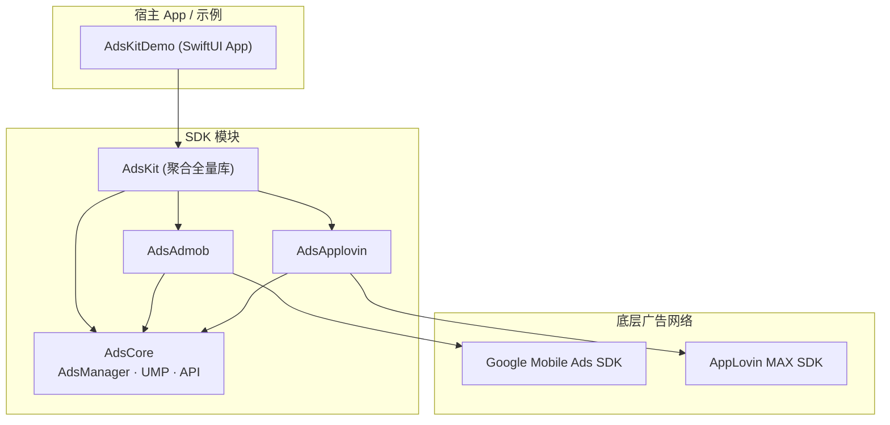
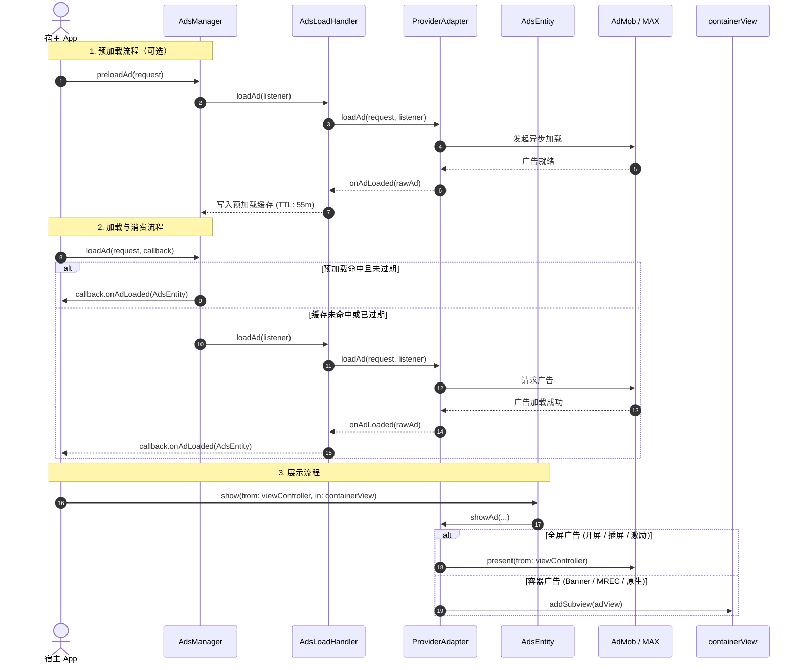

# AdsKit-iOS

iOS 广告聚合 SDK（Swift）：统一封装 **Google Mobile Ads (AdMob)** 与 **AppLovin MAX**，宿主 App 通过单一门面 `AdsManager` 快速接入。

---

## 核心特性

- **单适配器模式**：同一时刻仅生效一个 `AdsProviderAdapter`；切换 Provider 时自动清理旧适配器并清空预加载缓存。
- **主线程安全保证（MainActor）**：全套 API 与生命周期回调均严格绑定 `@MainActor`，彻底杜绝多线程数据竞争与并发崩溃。
- **预加载与 TTL 缓存**：以 `triggerId` 为唯一标识的非阻塞预加载，支持自定义或默认 55 分钟过期清理机制。
- **极简统一展示 API**：通过 `AdsEntity.show(from:in:)` 统一承载全屏展示（开屏、插屏、激励）与视图容器挂载（横幅、MREC、原生）。
- **内置 Google UMP 授权**：开箱即用集成欧洲经济区及国际隐私合规（User Messaging Platform）授权流程。

---

## 架构

### 模块依赖关系



### 运行时调用时序



---

## 支持的广告格式

| 格式 | 枚举 | AdMob 对应实现 | AppLovin 对应实现 | 展示容器参数 |
|---|---|---|---|---|
| **自适应横幅** | `AdsType.banner` | `BannerView` (Adaptive) | `MAAdView` (320x50) | 必填（`UIView` 容器） |
| **矩形横幅** | `AdsType.mrec` | `BannerView` (300x250) | `MAAdView` (MREC) | 必填（`UIView` 容器） |
| **开屏广告** | `AdsType.splash` | `AppOpenAd` | `MAAppOpenAd` | 忽略（全屏弹窗展示） |
| **激励视频** | `AdsType.rewarded` | `RewardedAd` | `MARewardedAd` | 忽略（全屏弹窗展示） |
| **插屏广告** | `AdsType.interstitial` | `InterstitialAd` | `MAInterstitialAd` | 忽略（全屏弹窗展示） |
| **原生广告** | `AdsType.native` | `NativeAdView` | `MANativeAdView` | 必填（`UIView` 容器） |

---

## 集成方式

### 方式一：Swift Package Manager（推荐）

在 Xcode 中点击 **File** > **Add Package Dependencies...**，输入仓库地址：
```
https://github.com/e-hai/AdsKit-iOS.git
```

或者在您的 `Package.swift` 中声明：
```swift
dependencies: [
    .package(url: "https://github.com/e-hai/AdsKit-iOS.git", from: "1.0.2")
]
```

### 方式二：CocoaPods

在 `Podfile` 中添加：
```ruby
# 集成全量包
pod 'AdsKit', :git => 'https://github.com/e-hai/AdsKit-iOS.git'

# 或按需引入（仅 AdMob）
pod 'AdsKit/Core', :git => 'https://github.com/e-hai/AdsKit-iOS.git'
pod 'AdsKit/Admob', :git => 'https://github.com/e-hai/AdsKit-iOS.git'
```

---

## 快速使用

### 1. 注册适配器

在应用启动入口（如 `@main App` 或 `AppDelegate`）注册适配器：

```swift
import SwiftUI
import AdsKit

@main
struct MyApp: App {
    init() {
        // 注册所有提供商适配器
        AdsKit.registerAllProviders()
    }

    var body: some Scene {
        WindowGroup {
            ContentView()
        }
    }
}
```

### 2. 收集 UMP 隐私授权并初始化 SDK（推荐合规顺序）

由于 SDK 集成了多个第三方中介适配器，为满足欧盟 GDPR 隐私合规要求（获取用户授权前不得触发三方 SDK 初始化），**请务必先执行 `UMP.start`，在回调 `canRequestAds == true` 后再调用 `AdsManager.initialize(...)`**：

```swift
import AdsKit

// 在主 UIViewController 或视图渲染完成后发起：
UMP.start(from: self, debugEnabled: false) { canRequestAds in
    guard canRequestAds else {
        print("未获得广告请求授权")
        return
    }

    // 授权成功后再初始化默认 Provider（logEnabled 与 debugEnabled 默认均为 false）
    let config = AdsProviderConfig(
        providerType: .admob,
        apiKey: "ca-app-pub-3940256099942544~1458002511"
    )
    #if DEBUG
    let isDebug = true
    #else
    let isDebug = false
    #endif
    AdsManager.initialize(
        config: config,
        logEnabled: isDebug,
        debugEnabled: false
    ) { success in
        print("AdsKit 初始化状态: \(success)")
        // 初始化成功后可安全加载或预加载广告
    }
}
```

### 3. 预加载广告（后台静默拉取）

```swift
let request = AdsRequest(
    triggerId: "home_splash",
    adUnitId: "ca-app-pub-3940256099942544/5575463023",
    adType: .splash,
    providerType: .admob,
    preloadTtlMs: 55 * 60 * 1000 // 可选，默认 55 分钟有效
)

AdsManager.preloadAd(request: request)
```

### 4. 加载并展示广告

调用 `loadAd` 时，SDK 会优先检查预加载缓存是否可用；若可用直接命中消费，否则自动发起实时网络请求：

```swift
AdsManager.loadAd(request: request, adListener: AdCallback(
    onLoaded: { entity in
        // 全屏广告展示（Splash / Interstitial / Rewarded）：
        entity.show(from: currentViewController)

        // 或容器广告展示（Banner / MREC / Native）：
        // entity.show(from: currentViewController, in: bannerContainerView)
    },
    onFailed: { error, errorCode in
        print("广告加载失败: \(error), 错误码: \(errorCode ?? "nil")")
    },
    onShown: {
        print("广告已展示")
    },
    onClicked: {
        print("用户点击广告")
    },
    onClosed: {
        print("广告已关闭")
    },
    onReward: {
        print("获得激励奖励")
    },
    onPaid: { paid in
        print("广告收益微积分: \(paid.valueMicros) \(paid.currencyCode)")
    }
))
```

---

## 运行 Demo 示例工程

仓库根目录已配备完整功能对齐的 SwiftUI 交互式 Demo 工程：

1. 在终端或 Finder 中打开工程：
   ```bash
   cd /Users/a/Develop/project/ios/AdsKit-iOS
   open AdsKitDemo.xcodeproj
   ```
2. 在 Xcode 顶部导航栏中：
   - 将 Scheme 切换为 **`AdsKitDemo`**；
   - 目标设备选择任何 iOS 模拟器（如 `iPhone 16` 或 `iPhone 17 Pro`）。
3. 按下快捷键 **`Cmd + R`**（Product > Run）编译并运行。
4. Demo 按照“先 UMP 授权 → 后初始化 SDK → 加载与展示广告”的合规顺序编排，包含 Provider 切换、6 种广告格式验证、预加载消费及实时事件日志面板。

---

## 运行单元测试

```bash
swift test --filter AdsCoreTests
```

---

## 配置注意事项

1. **`Info.plist` 必要字段**：
   - **AdMob App ID**：集成 Google Mobile Ads 必须在宿主 App 的 `Info.plist` 中配置 `GADApplicationIdentifier`（测试可使用 `ca-app-pub-3940256099942544~1458002511`），否则启动即崩溃。
   - **SKAdNetwork 标识列表**：在 `Info.plist` 中配置 `SKAdNetworkItems` 数组以提升广告归因效果。
   - **ATT 权限提示**：配置 `NSUserTrackingUsageDescription` 用于在 iOS 14.5+ 呈现个性化广告跟踪授权提示。
2. **Google 官方测试广告位**：
   - 开屏（App Open）：`ca-app-pub-3940256099942544/5575463023`
   - 横幅（Banner）：`ca-app-pub-3940256099942544/2934735716`
   - 插屏（Interstitial）：`ca-app-pub-3940256099942544/4411468910`
   - 激励（Rewarded）：`ca-app-pub-3940256099942544/1712485313`
   - 原生（Native）：`ca-app-pub-3940256099942544/3986624511`
   - 矩形横幅（MREC）：`ca-app-pub-3940256099942544/2934735716`

---

## 日志与调试开关

> [!IMPORTANT]
> **`logEnabled`** 与 **`debugEnabled`** 默认值均为 **`false`**，分别通过 `AdsManager.initialize(...)` 或 `UMP.start(...)` 传入；`AdsLogger` 与 `AdsDebug` 为 SDK 内部 SPI 类型（`@_spi(AdsKitInternal)`），不对外暴露引用。

| 参数 / 入口 | 默认值 | 作用与副作用 |
|---|---|---|
| `AdsManager.initialize(..., logEnabled:)` | `false` | **纯日志开关**：控制 SDK 内部是否输出 `[AdsKit-*]` 默认控制台日志，无业务副作用。 |
| `AdsManager.initialize(..., logHandler:)` / `AdsManager.setLogHandler(_:)` | `nil` | **外部日志拦截器**：非空时接管 SDK 全部日志输出（不再打印默认 `print`），可转发至自研日志库或崩溃上报；传 `nil` 恢复默认行为。 |
| `AdsManager.initialize(..., debugEnabled:)` | `false` | **广告 SDK 调试开关**：预留的调试模式标记（默认关闭）。 |
| `UMP.start(..., debugEnabled:)` | `false` | **UMP 独立调试开关（局部变量，不关联 `AdsDebug`）**：开启后会模拟 EEA 地区并重置隐私同意状态。**仅限本地调试，严禁线上开启。** |
| `UMP.start(..., umpTestDeviceIds:)` | `[]` | 仅用于真机调试 UMP 强制 EEA 地区弹窗时传入的哈希测试设备 ID 列表（仅 `UMP.start` 的 `debugEnabled: true` 时生效；AdMob 常规测试设备请在 AdMob 后台配置）。 |

```swift
// 可选：外部拦截 SDK 日志（例如转发至自定义日志库，无需依赖内部 AdsLogger）
AdsManager.setLogHandler { level, tag, message, error in
    // level: .debug / .warn / .error
    MyLogger.log(level.rawValue, tag: tag, message: message, error: error)
}
```

---

- 后台配置与上线 SOP 见 **[`docs/MEDIATION_SOP.md`](docs/MEDIATION_SOP.md)**。
- 更多架构与内存管理约定见 **`AGENTS.md`**。
