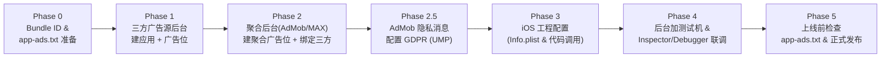

# AdsKit-iOS 广告聚合后台与接入 SOP

> **核心配置顺序：先在「各三方广告源后台」创建应用与广告位，再配置「聚合平台后台（AdMob / AppLovin MAX）」。**  
> 因为聚合后台配置 Bidding / Waterfall 时，必须填入上游三方广告源生成的 `App ID` / `App Key` 和 `Placement ID` / `Slot ID`。

---

## 整体流程



---

## Phase 0：前置准备

1. **确定 iOS Bundle Identifier**：在所有广告平台创建 iOS 应用时使用同一正式 Bundle ID。
2. **准备基础物料**：
   - 开发者官网根目录（用于部署 `app-ads.txt`）。
   - 应用隐私政策链接（Privacy Policy URL，配置 UMP GDPR 弹窗必需）。
   - App Store 商店链接（未上架前可先创建测试应用，上架后及时补充 Store URL 以免影响填充）。

---

## Phase 1：先在「各三方广告源后台」创建应用与广告位

结合 `AdsKit-iOS`（`AdsAdmob` / `AdsApplovin`）已集成的适配器，按业务需要开通并创建对应三方源：

| 广告源 | 需在三方后台获取的应用级/账号级凭证 | 需按格式创建的广告位凭证 |
|---|---|---|
| **Meta Audience Network** | App ID + System User Access Token（Bidding） | Placement ID（Banner / Interstitial / Rewarded / Native / MREC） |
| **Pangle (穿山甲海外)** | App ID + Security Key / Role ID（API 报表） | Slot ID（按格式与 Bidding/Waterfall 类型创建） |
| **Mintegral** | App ID + App Key + SKey / API Key | Placement ID + Unit ID |
| **Unity Ads** | Game ID + Organization Core ID / API Key | Placement ID（如 `Banner_iOS`, `Rewarded_iOS`） |
| **Liftoff (Vungle)** | App ID + Reporting API Key | Placement Reference ID |
| **InMobi** | Account ID + Placement API Key | Placement ID |
| **ironSource** | App Key + Secret Key / Refresh Token | Instance ID / Bidding 配置 |
| **Chartboost** | App ID + App Signature | Ad Location / Placement Name |
| **DT Exchange (Fyber)** | App ID + Reporting API Key | Spot ID |

> [!TIP]
> **Bidding vs Waterfall 建位规范**：
> - 优先为支持 **In-App Bidding（实时竞价）** 的广告源创建 Bidding 类型广告位；
> - 若聚合组同时保留 **Waterfall（瀑布流底价）** 兜底，需在三方后台单独创建对应底价的普通广告位（不可与 Bidding 混用同一 Placement ID）。

---

## Phase 2：再在「聚合平台后台」创建应用、广告位与聚合组

### 分支 A：使用 **AdMob** 作为聚合层（`.admob`）
1. **创建 iOS 应用**：在 AdMob 后台创建 iOS 应用，获取 **AdMob App ID**（格式 `ca-app-pub-xxx~yyy`）。
2. **创建聚合广告位**：按业务场景创建 `Ad Unit ID`（格式 `ca-app-pub-xxx/zzz`），对应 `AdsType`：
   - `.banner`、`.splash`（App Open）、`.rewarded`、`.interstitial`、`.native`、`.mrec`。
3. **创建 Mediation Group（中介组）**：
   - 在 **Mediation → Mediation groups** 中按平台、广告格式及国家/地区创建分组，关联第 2 步的 AdMob Ad Unit ID。
   - 在 **Bidding** 与 **Waterfall** 区域添加 Phase 1 准备好的三方广告源，填入三方 App ID / Placement ID，并配置三方账号 API 凭证以开启自动 eCPM 优化。
4. **配置 UMP（Privacy & messaging）**：
   - 在 AdMob 后台 **Privacy & messaging → GDPR** 中创建同意消息并绑定当前 iOS 应用（**注意：即使未来切到 AppLovin MAX，只要使用 Google UMP 弹窗，也必须在 AdMob 后台创建好对应 iOS 应用并绑定 GDPR 消息**）。

### 分支 B：使用 **AppLovin MAX** 作为聚合层（`.applovin`）
1. **获取 SDK Key**：在 AppLovin 后台 **Account → Keys** 获取全局 **SDK Key**。
2. **创建 MAX Ad Unit**：在 **MAX → Mediation → Manage → Ad Units** 中选择 iOS 平台并按格式创建广告单元，获取 16 位 **MAX Ad Unit ID**。
3. **绑定上游广告源**：
   - 在对应 MAX Ad Unit 内启用 **Bidding** 与 **Waterfall** 广告源，填入 Phase 1 获取的各三方 App ID 与 Placement ID。
   - **若 MAX 中同时聚合 Google AdMob**：需把分支 A 中创建的 iOS AdMob App ID 与 AdMob Ad Unit ID 作为上游广告源填入 MAX 后台。

---

## Phase 3：iOS 工程配置与 `AdsKit` 代码接入

1. **配置 `Info.plist`**：
   - **`GADApplicationIdentifier`**：配置正式的 AdMob App ID（即使主聚合选 MAX，只要包内引入了 Google Mobile Ads 适配器就必须配置，否则启动即崩溃）。
   - **`NSUserTrackingUsageDescription`**：配置 iOS 14.5+ ATT（App Tracking Transparency）授权文案。
   - **`SKAdNetworkItems`**：合并 AdMob、AppLovin MAX 以及所有启用三方广告源的 `SKAdNetworkIdentifier` 列表，保证 iOS 归因正常。
2. **注册适配器并按 GDPR 合规顺序调用代码**（`registerAllProviders` → `UMP.start` → `AdsManager.initialize` → `loadAd`）：
   ```swift
   // 1. 启动入口注册适配器
   AdsKit.registerAllProviders()

   // 2. 在主 UIViewController 就绪后先收集 UMP 隐私授权，再初始化广告 SDK
   UMP.start(from: viewController, debugEnabled: false) { canRequestAds in
       guard canRequestAds else { return }

       let config = AdsProviderConfig(
           providerType: .admob,
           apiKey: admobAppIdOrMaxSdkKey
       )
       AdsManager.initialize(
           config: config,
           logEnabled: false,
           debugEnabled: false
       ) { success in
           if success {
               // 安全加载或预加载广告
           }
       }
   }
   ```

---

## Phase 4：测试设备登记与联调验收

1. **后台登记测试机（防封号）**：
   - 在 **AdMob 后台（Settings → Test devices）** 和 **AppLovin 后台（MAX → Test Mode）** 分别录入测试机的 iOS **IDFA**。
2. **使用内置调试面板逐一验通适配器**：
   - 调用 `AdsManager.openDebug(from: viewController)` 打开 **AdMob Ad Inspector** 或 **MAX Mediation Debugger**。
   - 核对清单：所有已接入的三方适配器是否均为 `Initialized / Ready`，以及各广告位 Bidding / Waterfall 是否正常回填。
3. **UMP 弹窗测试**：
   - 仅在本地测试环境将 `UMP.start(from: vc, debugEnabled: true, umpTestDeviceIds: [...])` 打开，确认 EEA 隐私弹窗正常弹出与同意回传。

---

## Phase 5：上线前检查 Checklist

- [ ] 确认 `AdsManager.initialize(...)` 的 `debugEnabled` 为 `false`，`UMP.start(...)` 的 `debugEnabled` 为 `false`。
- [ ] 确认工程中的 `GADApplicationIdentifier`、MAX SDK Key 及各广告位 Ad Unit ID 已全部从测试 ID 替换为正式 ID。
- [ ] 确认 `Info.plist` 中的 `SKAdNetworkItems` 已覆盖所有已启用的三方广告源。
- [ ] 合并 AdMob、AppLovin MAX 及所有上游三方广告源提供的 `app-ads.txt` 记录，部署至开发者官网根目录 `https://<your-domain>/app-ads.txt` 并在各后台触发校验。
